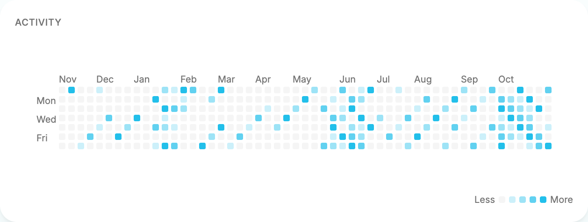

# Motrix for Synology DSM

Motrix downloads files and torrents directly on your NAS. This experimental native
SPK includes Node.js, Motrix Server and Web UI, aria2, and the filesystem helper.
It does not need Docker at runtime, download dependencies during installation,
or run npm on the NAS. Author: [Dr_rOot](https://github.com/agalwood).

Install the matching SPK with **Package Center → Manual Install**. This package
has **not** been published to Synology's package store. Do not describe it as a
store listing. Verify its adjacent `.sha256` file before installation.

## Supported scope

Native x86_64 and ARM64 SPKs target **DSM 7.2.2-72806 or later**. It is an
**administrator-shared instance**: all authorized local DSM administrators can
manage the same tasks, settings and plugins. Ordinary, disabled, domain and LDAP
accounts are denied. There is no per-user task isolation or quota accounting.

One ARM64 SPK contains one AArch64 payload. Its INFO lists the three Package Arch values below, based on the [official DSM firmware archive](https://archive.synology.com/download/Os/DSM/7.2.2-72806-9).

| Package Arch | Models |
| --- | --- |
| rtd1296 | DS118, DS218, DS218play, DS220j, DS418, DS418j, DS420j, RS819 |
| rtd1619b | DS124, DS223, DS223j, DS423 |
| armada37xx | DS119j, DS120j |

The builder checks the same archive against all three official sysroots and exercises its binaries under Cortex-A53 CPU emulation. Low-memory models need hardware memory-pressure testing. The separate `rtd1619` platform lacks a matching toolchain in the pinned SDK directory. ARMv7/32-bit is outside this package. DS718+ and DS423+ take the x86_64 build. [Toolchain directory](https://archive.synology.com/download/ToolChain/toolchain/7.2-72806) · [Synology platform mapping](https://help.synology.com/developer-guide/appendix/platarchs.html)

**Dashboard in 2.3.0-11.** On a DS718+ running revision 10, a healthy activity refresh showed a stale notice and shrank the calendar from 186 to 162 pixels high. In isolated Chromium, the final revision 11 ARM64 SPK completed a ticket renewal through a simulated DSM gateway. At 597 pixels wide the calendar showed 12 month labels and three weekday labels, and the engine title stayed Ready. When the snapshot request failed, the notice and Retry appeared in the header without moving or resizing the grid. This test ran in a Linux container. Revision 11 hardware acceptance remains open.

**Dashboard in 2.3.0-12 on DSM 7.4.1.** After upgrading the DS718+ from
revision 10, a fresh Dashboard requested one opening ticket. A listener attached
to the same open WebSocket observed three renewal challenges over 110 seconds.
Each received HTTP 204, with no socket closure or additional opening ticket.
Across 180 seconds of layout observation, the calendar stayed 597 × 186 CSS
pixels with 12 visible month labels and three weekday labels. Their positions
stayed fixed, no stale notice appeared, and the Engine title stayed Ready.



On 2026-11-07, **2.3.0-10** passed a directory replacement test on a **DS718+
(DSM 7.4.1)** after a manual upgrade from 2.3.0-9. A completed HTTP task had
written 27,648 bytes to an explicitly authorized test directory. Substituting
a different directory and file at the same paths caused Motrix to deny reading
and deleting the old task’s file. Both files retained their original hashes.
Restarting with the substitute in place opened the recovery page and stopped
the engine. Saving the same folder list could not transfer the grant. After
restoring the original directory and restarting, HEAD and GET returned 200
and the downloaded bytes matched the source SHA-256. Removing the test task
with its file then succeeded.

On 2026-11-07, Package Center upgraded **2.3.0-8 to 2.3.0-9** on a **DS718+
(Apollo Lake) running DSM 7.4.1**. The installed build matched the verified SPK.
Opening Motrix from DSM loaded the administrator dashboard. Renaming an empty
authorized test directory put Motrix into folder recovery on the next start.
The engine stopped, the direct client port closed and anonymous requests could
not see the path. The administrator restored the original folder list in the
recovery page. Restarting Motrix returned the server and engine to ready.
The Web UI downloaded a 33,280-byte HTTP file into the restored directory.
Its owner was `motrix`, its SHA-256 matched the source, and removing the task
with its file cleared both.

With the installed Chrome extension 0.1.23, two tabs signed in as the same administrator saw the
same pairing request in Integration settings. Only the page that claimed the
request received the code. The extension submitted it 99 seconds after starting
the request, connected over WSS and read the active task list. Revoking the test
credential disconnected the extension. After acceptance, the extension used
its original backend, Motrix had no test tasks, HTTP pairing codes and the WSS
entry were off, and the direct client port was 16802.

Earlier revision **2.3.0-8** passed native checks for administrator login, package settings,
configurable client port, NAS torrent selection, File Station navigation, file
streaming with HEAD/Range, selected-file deletion and retained historical tasks.
A 4 MiB HTTP download resumed across the 2.3.0-6 → 2.3.0-7 upgrade with the
expected SHA-256. Revision 8 also restored the single-file metadata missing
from older HTTP history.

Earlier revision 2.3.0-5 passed real HTTP/BT downloads, redownload, directory and
symlink denial, nonroot process checks, and CLI protocol pairing/revocation.
Synthetic tasks/files and temporary servers were removed after acceptance. The
direct client port was restored to 16802, and the extension entry remains off.
This does not establish support for every DSM release or model.

Linux simulation and checksum-pinned Gemini Lake/Apollo Lake DSM 7.2.2 userspace
ABI checks also passed. The minimum version records the toolchain/resource
contract. The actual device uses Linux 4.4.302; [Node 24's upstream supported
Linux kernel baseline](https://github.com/nodejs/node/blob/v24.x/BUILDING.md) is
newer. Basic device operations passed, but long-running downloads, live account
disable/recreation, ACL revocation, physical volume removal or replacement and interrupted
finalization still need controlled device tests. The published Motrix CLI 0.5.0
paired through the DSM HTTPS gateway and ran `list` and `stats`. Across a package
restart the same credential received HTTP 403 until the administrator reopened
Motrix, then HTTP 200. Revocation returned HTTP 401. The test container resolved
the certificate hostname to the NAS LAN IP and verified the TLS chain and name.
Chrome extension 0.1.23 paired through WSS after the Mac resolved the DSM
certificate hostname to the NAS LAN address. The administrator claimed the code
and entered it in the extension. The extension reconnected after a package
restart and fresh Web authentication, ran task and stats queries, and added
and deleted a 51-byte test download. Its SHA-256 matched the source. Revocation
disconnected the extension and denied subsequent task queries.
ARM64 userspace coverage is listed above. Physical ARM NAS acceptance remains open.

## Use and permissions

Open Motrix from the DSM desktop while signed in as a local administrator. The
entry uses the same DSM host and port, at `/motrix/`, including HTTP, WebSocket
and static asset paths. Web Station is not required; File Station must be available for effective ACL queries. The application has no
separate password and does not collect DSM passwords. The package joins DSM’s `http` group using the official privilege mechanism.
Only the upstream socket is shared as `motrix:http`, mode `0660`, so the
unprivileged Nginx gateway can connect. Private settings and application data
remain owner-only; group membership never replaces session/account authentication.

The `motrix` package account runs the Web service, download engine, plugins and
filesystem helper. No package process is elevated to root; the SPK requests no
setuid program, Linux capability, sudo rule or privileged helper. DSM's resource
workers create the `motrix` shared folder and register the Nginx configuration.
The `http` group also provides access to DSM's existing local SCGI socket. The
adapter calls only fixed vendor routes: `login.cgi` retrieves the current
session's SynoToken, `SYNO.Core.NormalUser.get` identifies its owner, and
`SYNO.Core.User.get` queries that local account's `expired` status. Nonprivileged
`id` queries independently check UID and current membership of group 101.
File Station `List.getinfo` supplies effective ACL rights for the exact requested
path; the returned physical path must match. No API can read file contents or
mutate DSM settings through this adapter. Raw responses and credentials are
never returned in diagnostics.

Downloads are restricted to existing, mounted, canonical configured roots and
the permissions of both the account and the package user. The default root is
resolved from DSM's `/var/packages/Motrix/shares/motrix` link. An unavailable
volume is never created as a replacement directory on the system volume.
Revision 10 records the filesystem device and inode of each authorized root.
The package checks those identities when it starts and during file operations.
A different directory at the same path cannot inherit the old grant, including
when the directory changes between saving settings and restarting. Restore the
original directory, or authorize a different path for the replacement.
When upgrading a path-only configuration, the first startup with every root
available records the directories present at that point.
If a configured download folder is missing or inaccessible at startup, Motrix
opens an administrator-only recovery page. Restore the affected folders or edit
the list, then restart Motrix in Package Center. While that page is active, the
engine, plugins and client listeners stay stopped and task storage stays intact.
The package volume and package data directory must still be available.

Use **Settings → NAS** to manage authorized directories and client connections.
First grant the internal system user `motrix` access in DSM's shared-folder
permissions. Add an existing path such as `/volume1/downloads` to Motrix's
root list, apply, then stop and start Motrix in Package Center. Changes are
queued and take effect after the old engine has stopped; the interface shows
pending changes and currently active connection addresses. Concurrent edits
require reloading the latest settings instead of silently overwriting them.
The folder picker only browses authorized roots; selection never grants access.
Backend checks cover new tasks, resume, redownload, BT selection and file removal.

Upload a local `.torrent`, or choose a torrent from an authorized NAS directory.
Completed single-file tasks offer **Download to this device**; the server streams
from a verified file handle and supports resumable HTTP ranges. **Show in File
Station** opens the task folder in DSM. Its launch URL was verified on DS718+
with DSM 7.4.1; other DSM versions still require device acceptance. No File Station
`.torrent` context-menu association is registered.

Revision 13 binds each task to its physical download directory. Before serving a completed file or deleting its payload, Motrix checks the original publication record or a verified torrent. If an older task or partial download has no ownership record, you can remove the task while keeping its files. Use **Locate** or **Recheck** with the original torrent to verify an existing BT download. A multi-file torrent directory containing an unrelated file is preserved.

Engine startup loads persisted work paused, verifies task ownership and actual
output paths against current grants, then resumes authorized tasks that were
previously running. Unknown or unauthorized engine rows remain paused. Automatic
reconstruction of lost tasks also checks the host's directory grants.
Directory grants and account/ACL state are refreshed on admission. Removal uses
the existing descriptor-relative filesystem helper, file identity checks and
persistent removal recovery journal. Revoking a grant does not instantly cancel
an engine file that is already open; stop the package before withdrawing a
background download grant. Device tests must cover DSM ACL inheritance, mount
replacement, offline storage and interrupted finalization.

## Pair clients

The installation wizard selects the direct client port (default **16802**).
In **Settings → NAS**, copy the CLI address using the DSM HTTPS origin and
`/motrix/client`. The gateway forwards only the existing CLI protocol routes;
it does not forward DSM cookies. The direct port remains available and configurable.

Browser extension access is disabled by default. Enable it in **Settings → NAS**;
the suggested address uses the current DSM origin and `/motrix/bridge` with WSS
for HTTPS. Advanced connection fields support a separately configured public
origin. Set the full Motrix Web address including `/motrix/`.
Use a hostname covered by DSM’s HTTPS certificate for both client addresses.
On a LAN, configure DNS so that hostname resolves to the NAS LAN IP. An IP-based
address requires that exact IP in the certificate. Chrome’s extension background
process validates its own TLS connection even when a DSM tab is already open.
Displaying pairing codes over HTTP requires explicit trusted-network consent.
The configured origin must match the current page; an HTTPS address never
permits code delivery to an HTTP page. Apply and restart the package for changes
to take effect. Invalid configuration closes the extension entry.
The existing CLI device-code protocol and Extension MBP1 protocol are unchanged.
Open **Settings → Integration → Browser pairing requests** to find a pending
request while its code is valid. The pairing UI shows the current account and
**Pair with current account**.
Next, enter the code in the browser extension. The server checks the page's
expected account against the current trusted account. Shared notifications
contain no pairing code; only the claimant receives it.

Client credentials bind to a local account ID and an account-database generation.
Every client request rechecks authoritative account state. Disable, expiration,
demotion, missing records or an authority failure deny access. Any change to the
root-owned local passwd/group database conservatively invalidates all existing
bindings, including after UID reuse; pair again. Explicit credential revocation
continues to use the existing protocol. DSM session cookies are neither saved in
pairing state nor used as CLI credentials. At most 64 session contexts are kept
in memory with bounded least-recently-used eviction; every client operation
revalidates the actual DSM session and account. A DSM logout, session expiry,
evicted context or Motrix restart requires the corresponding administrator to reopen
Motrix. Paired credentials and tasks survive an upgrade, but no client is allowed
to act until its account has supplied a fresh verified session. Web event tickets are one-use,
origin-bound and short-lived. Starting with revision 12, the DSM Dashboard keeps its
event WebSocket open across successful account checks. About 45 seconds into a
60-second authorization window, the server sends a one-use challenge to that
socket. The browser answers via same-origin HTTPS using its current DSM session.
Only the same verified administrator, account revision and origin can extend
the window. A missed deadline, rejected session or changed account closes the
stream. A lost network connection or package restart still requires reconnecting.
Clients without renewal support reconnect when the window expires.

If the account cannot be verified, the page shows a bounded diagnostic such as
`account / rejected` or `account / commandFailed / accessDenied`.
The same metadata is available at `/motrix/rpc/auth/status` in the signed-in
browser. It contains no Cookie, token, account name or raw command output.
Session and account checks still fail closed; a diagnostic is not an authorization
fallback. The proxy forwards the CGI scheme and port, while the backend supplies
the bounded host/user-agent context to DSM’s authentication program.

## Lifecycle and retained data

Package lifecycle scripts run as the package user and serialize with `flock`.
PID records include process birth time, boot identity and executable/entrypoint
checks. Stop waits for orderly shutdown and retains the record on timeout.
Upgrade stops the old process before replacement and preserves the DSM FHS
`var` directory: task database, configuration, plugins, pairing bindings and
removal recovery state. Downloads remain in the shared folder.

Uninstall defaults to keeping application data. The explicit **Delete tasks,
settings and paired clients** option deletes only package-owned state after a
successful stop. Downloaded files are always retained. Reinstalling with retained
data restores the same shared instance, subject to current account and directory
permissions. In a Linux simulation using the final revision 9 SPK, reinstalling
with retained data preserved database and engine files byte for byte and
restored the existing task and settings. The old CLI credential could query the
task after the administrator reopened Motrix. Reinstalling after explicit data
deletion started with an empty task list and rejected the old credential. Both
reinstall paths preserved the HTTP and BitTorrent downloads. DSM controls the
lifecycle sequence and resource cleanup. Fresh install, repair and uninstall
retention still need acceptance on a physical NAS.

## Controlled DSM device acceptance

Use a spare DSM or isolated Virtual DSM. Create a test administrator, disposable shared folder and completed synthetic download. Record the task ID, file SHA-256, settings and a successful test client query. Keep a separate administrator session. Use temporary client profiles for credentials.

| Scenario | Procedure and pass criteria | Effect on data |
| --- | --- | --- |
| Account demotion or disablement | Pair the test CLI and extension. Remove the test account from administrators using the other administrator session. Requests from its existing Web session and clients must be denied. Repeat with account disablement. Restore membership, sign in again and pair again as needed. Check the task and file hash. | Downloads remain on disk. Changes to the account database may invalidate other existing pairings. |
| Volume loss and recovery | Install the package and its data on test volume A. Put the test download root on a separate disposable volume B. Stop Motrix, power down and safely detach only the disk for B. Boot DSM and start Motrix. Expect the recovery page, a stopped engine, a closed client port and no recreated folder. Power down, restore B, then verify the folder identity, task and file hash. If device identity changes, explicitly authorize another path in recovery. | All services and shares on B lose access while offline. Removing a pool or volume erases data. Use a test disk independent of production, system and RAID-member disks. [Synology storage pool guide](https://kb.synology.com/en-id/DSM/help/DSM/StorageManager/storage_pool_create_storage_pool?version=7) |
| Uninstall and reinstall | Back up the disposable instance's package state and download. Uninstall keeping application data and reinstall the same version and architecture. Reopen Motrix and verify the task, settings, old credential and file hash. On a disposable instance repeat with explicit data deletion. Expect an empty task list and a rejected old credential, with the shared file unchanged. | Both paths stop the service. Explicit data deletion clears all tasks, settings and pairings for that instance. |

## Build and verification

Use Node 24.18.0, the repository's pinned pnpm and Rust versions, Python 3.12+
(or Python 3.11 with tar extraction filters), and Docker for isolated acceptance.
Use a native Linux runner with its Rust musl target and GNU binutils. ARM64 also requires qemu-user. To build x86_64, set `arch=x64` in this example.

```sh
arch=arm64
MOTRIX_SKIP_ELECTRON_REBUILD=1 MOTRIX_SKIP_ENGINE_FETCH=1 pnpm install --frozen-lockfile
pnpm run fetch:engine -- --platform linux --arch "$arch"
pnpm run build:server
pnpm run stage:server -- --platform linux --arch "$arch" --libc gnu --strict
pnpm run build:synology -- --arch "$arch" --output-dir "release/synology-$arch/project"
pnpm run verify:synology -- --spk "release/synology-$arch/Motrix-2.3.0-13-dsm-$arch.spk"
```

The `synology.yml` GitHub Actions workflow builds on native x64 and ARM64 runners and verifies each final archive. After a successful stable release, `synology-publish.yml` rebuilds the exact tagged commit for both architectures. The protected publication job checks the tag, source commit, complete SPKs, digests and per-platform ABI reports before attaching them to the existing GitHub Release. Retries preserve existing assets. Synology Package Center store publication is separate.

For local read-only verification, place the `.spk`, `.spk.sha256` and `.spk.abi.json` files for both architectures in one directory. Use the application version and full source commit from the SPK receipt.

```sh
python3 scripts/synology_publication.py verify "$asset_dir" "$version" "$source_sha"
```

Use a fresh output directory for every build. A higher numeric revision creates
an upgradeable SPK while retaining the application version. Cross-building on
macOS additionally requires building the Linux helper from the locked Rust
source; do not substitute a host binary. The build reuses Server staging,
external-module pruning, engine integrity checks, signed builtin verification
and license generation. Node's archive is pinned by the existing NAS runtime
lock. No Electron, npm, source compiler or toolchain is installed on the NAS.

The SPK builder unpacks the actual outer archive and nested `package.tgz`, rejects
traversal/links/duplicate names/macOS metadata, verifies payload hashes and
executable modes, then reruns Server package verification. It checks every ELF's
architecture, dynamic dependencies and symbol versions against the checksum-pinned
Synology sysroots for the package targets. It also loads bundled Node and SQLite through the
DSM loader and exercises SQLite read/write. aria2 and the filesystem helper are
static. The SDK is a build input and is not redistributed inside the SPK.

The build runs ordinary Server smoke and DSM lifecycle simulation against the
**extracted SPK bytes**. A simulated DSM SCGI API exists only inside
a disposable container. It validates integration behavior, not the availability,
output format or permissions of DSM's real API. The package receipt records the source commit and whether the source tree was
dirty. Keep `.abi.json` and test
logs with the SPK and its SHA-256. Do not publish a release or claim device
compatibility based on those reports alone.

## Implementation evidence and limits

Sources reviewed for DSM 7.2.2 and DSM 7.4.1; device checks updated 2026-11-07:

| Area | Basis and implementation boundary |
| --- | --- |
| Package layout and metadata | [SPK layout](https://help.synology.com/developer-guide/synology_package/introduction.html), [INFO](https://help.synology.com/developer-guide/synology_package/INFO.html), and [localized fields](https://help.synology.com/developer-guide/synology_package/INFO_optional_fields.html). English fallback plus `chs`/`cht` descriptions and wizard files. |
| Least privilege | [Privilege configuration](https://help.synology.com/developer-guide/privilege/privilege_config.html) and the [official web-package group example](https://help.synology.com/developer-guide/examples/compile_web_package.html). Use `run-as: package` and `join-groupname: http`; root packages require additional Synology authorization. |
| Storage and lifecycle | [DSM FHS](https://help.synology.com/developer-guide/integrate_dsm/fhs.html), [data-share](https://help.synology.com/developer-guide/resource_acquisition/data_share.html), and [wizard contracts](https://help.synology.com/developer-guide/synology_package/wizard/WIZARD_UIFILES_v2.html). FHS data survives upgrades; the resource worker does not delete the download share. |
| Desktop and proxy | [Desktop config](https://help.synology.com/developer-guide/integrate_dsm/config.html), [web-config](https://help.synology.com/developer-guide/resource_acquisition/web_config.html), and [Web Station alternative](https://help.synology.com/developer-guide/resource_acquisition/web_service.html). Use DSM's Nginx worker with a Unix upstream and explicit WebSocket forwarding. No fnOS identity Header. |
| Session identity | [Application authentication](https://help.synology.com/developer-guide/integrate_dsm/web_authentication.html) establishes the cookie/CGI context. Direct `authenticate.cgi` execution and the privileged r4 broker are not used. The `login.cgi` bootstrap and `SYNO.Core.NormalUser.get` read calls were verified with a real DSM 7.4.1 browser session. The local SCGI transport remains version-sensitive and must be tested on each DSM release. |
| Account/ACL status | `SYNO.Core.User.get` with only `additional=["expired"]` was verified on DSM 7.4.1; requesting `groups` additionally returns error 3106. Local UID and administrator membership use nonprivileged `id`. The [official File Station API](https://global.download.synology.com/download/Document/Software/DeveloperGuide/Package/FileStation/All/enu/Synology_File_Station_API_Guide.pdf) documents `List.getinfo` and effective ACL fields; browser requests were verified against two explicitly authorized shares. Those API checks do not establish complete SPK/device acceptance. |
| Architecture | [Official architecture mapping](https://help.synology.com/developer-guide/appendix/platarchs.html) and [model/CPU list](https://kb.synology.com/en-global/DSM/tutorial/What_kind_of_CPU_does_my_NAS_have). DS920+/DS220+ are Gemini Lake; DS220j is RTD1296 (ARMv8), not x86_64. |
| Toolchain | [Official toolchain selection](https://help.synology.com/developer-guide/compile_applications/download_dsm_tool_chain.html), [environment preparation](https://help.synology.com/developer-guide/getting_started/prepare_environment.html), and [spksrc Gemini Lake inputs](https://github.com/SynoCommunity/spksrc/tree/master/toolchain/syno-geminilake-7.2). The exact archive SHA-256 is recorded in `scripts/synology-runtime.lock.json`. |
| Mature packaging reference | [SynoCommunity/spksrc](https://github.com/SynoCommunity/spksrc) and its [Transmission lifecycle](https://github.com/SynoCommunity/spksrc/blob/master/spk/transmission/src/service-setup.sh) informed FHS persistence and isolated package-user execution. No install-time dependency fetching is copied. |
